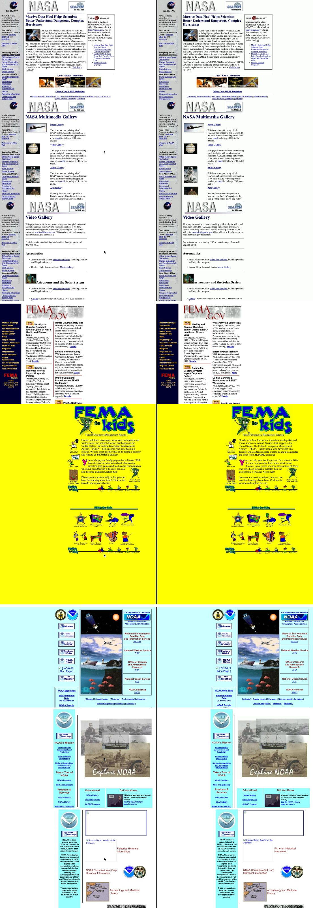

# Resurrection

Give it a video of someone using an old app. Get back a working web app that looks and behaves the same, with a score that proves it.

Built for the [Meta Global AI Developer Hackathon](https://cerebralvalley.ai/e/meta-ai-developer-hackathon) (Oct 27 to Nov 4, 2026). Everything in this repository was written during the hackathon.

## Why

Companies and public services still run apps whose source code is lost. Web archives and museums keep videos and screenshots of sites that no longer exist. A video is often the only thing left. Resurrection turns that video back into something you can click.

## How it works

1. **Read the video.** Muse Wonder watches someone use the old app and writes a JSON spec: the screens, the components on each screen, and what every click does.
2. **Rewrite the app.** Muse Code turns the spec into modern HTML, CSS and JS.
3. **Restore the visuals.** Muse Image redraws icons, logos and backgrounds that are too pixelated or missing.
4. **Prove it.** Playwright redoes the same clicks on the new app, and both sides are compared step by step:
   - **look**: frame by frame similarity (SSIM);
   - **layout**: SAM 3.1 finds buttons, text fields and images on both sides, and we measure whether they sit at the same place with the same size (IoU);
   - **journey**: does each click lead to the same screen?
5. **Fix and repeat.** The score report goes back to Muse Code until the score passes a threshold.

```
video ──► Muse Wonder ──► spec.json ──► Muse Code ──► index.html ──► Playwright replay
                                            ▲                              │
                                            └──── score report ◄── SSIM + SAM 3.1 + journey
```

What it does not do: the new app copies what the video shows. It cannot recover a backend or data the video never showed, and we say so in the demo.

## Quick start

```bash
python3 -m venv .venv && source .venv/bin/activate
pip install -e '.[dev]'
playwright install chromium

# film the example app, then resurrect it from that video
resurrect build examples/robot-club.json --out out/original.html
resurrect film examples/robot-club.json out/original.html samples/robot-club.mp4
cp examples/robot-club.json samples/robot-club.json
resurrect run samples/robot-club.mp4
```

Each round writes `out/<video>/round_N/` with the app, the captured frames and `report.json`.

Until the Meta models are plugged in, `run` uses offline stand-ins: the spec is read from a JSON file next to the video (`--reader spec-file`) and the app is drawn from a template (`--writer template`).

To score an app written by hand (or by a coding agent) against a video:

```bash
resurrect frames samples/my-app.mp4                  # frames named by timestamp
resurrect score samples/my-app.mp4 spec.json index.html
```

During development we use Claude Code in place of the Meta models to save API credits; the procedure is in [CLAUDE.md](CLAUDE.md). The demo runs on Meta models.

## Layout

```
resurrection/
  spec.py       the JSON spec shared by every step
  providers.py  one interface per model (Muse Wonder, Muse Code, Muse Image, SAM 3.1)
  template.py   baseline app, and the contract every generated app follows
  replay.py     redo the clicks with Playwright, capture both sides
  score.py      look (SSIM), layout (IoU), journey
  loop.py       the agent loop
  bench.py      Resurrection Bench (assemble tasks, score entries)
  cli.py        resurrect run | frames | score | build | film | bench
bench/          the benchmark: real 1999 sites, ground truth, entries
examples/       a small 2004-style site to test with
samples/        your videos (not committed)
tests/
```

**Contract for generated apps:** every component keeps `data-id="<component id>"` from the spec, and `<body data-screen="...">` always names the visible screen. The replay depends on both.

## Benchmark

**[See the results page by page](https://redaelm47.github.io/resurrection/bench/)**: original and rebuilt screens side by side, and the rebuilt sites to click through.

[Resurrection Bench](bench/README.md) scores any system on real 1999 websites from the Wayback Machine. A system only gets the video; we keep the real pages, click positions and element boxes as ground truth.

| System | fema-1999 | nasa-1999 | noaa-1999 | Look | Layout | Journey | **Score** |
|---|---|---|---|---|---|---|---|
| blank | 0% | 0% | 0% | 0% | 0% | 0% | **0%** |
| screenshot | 20% | 19% | 20% | 32% | 1% | 33% | **20%** |
| claude-code | 75% | 81% | 80% | 82% | 65% | 100% | **79%** |

First results (Oct 27, 2026). `claude-code` is Claude Code standing in for the Meta models while we save API credits: it got only the video, cropped images from its frames and wrote the pages. Meta model entries come next.



## Status

| Step | State |
|---|---|
| Spec format, replay, scoring, loop | working with offline stand-ins |
| Muse Wonder (video to spec) | to plug in |
| Muse Code (spec to app, fixes) | to plug in |
| Muse Image (visuals) | to plug in |
| SAM 3.1 (layout judge) | to plug in |

## Team

- Samir ([LM62bc](https://github.com/LM62bc))
- Mossa'ab ([M-Jel](https://github.com/M-Jel))
- Reda ([Redaelm47](https://github.com/Redaelm47)), help on evaluation

## License

[MIT](LICENSE). Third-party licenses and terms: [THIRD_PARTY_NOTICES.md](THIRD_PARTY_NOTICES.md).
